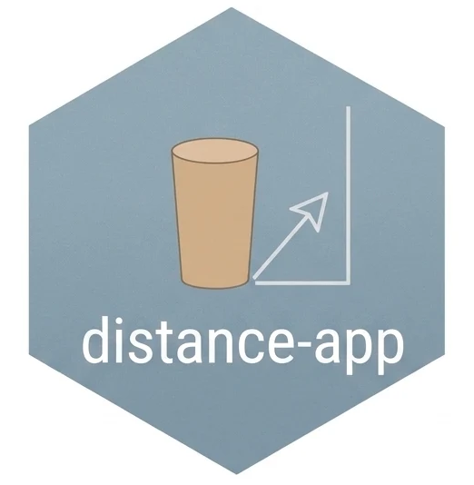

# Line Transect Distance Sampling:<br>Interactive Shiny Application 

An interactive R Shiny application designed for teaching and practising **Line Transect Distance Sampling** (`Distance::ds()`). Built around a field practical using bottle caps and corks as a biological analogy, this tool guides users from raw field CSV ingestion and automated data cleaning through to exploratory visualisation, detection function modelling, AIC model selection, and results export.

The application is available online on Posit Connect Cloud at [https://florianorgeret-distance-app.share.connect.posit.cloud/](https://florianorgeret-distance-app.share.connect.posit.cloud/), and can also be run locally in RStudio or Positron.

## 1. The Corks Practical

In field ecology, observers rarely detect every individual present in a survey area: detectability decreases as perpendicular distance from the transect line increases. To experience this principle hands-on before working with marine or terrestrial wildlife datasets, students conduct a line transect survey on a lawn using scattered bottle caps and corks.

### Biological Analogy
Each category or colour of cork represents a **distinct biological species** with its own intrinsic detectability profile:
- **Conspicuous categories** (e.g., `Bouchon rose`, `Bouchon bleu`): analogous to large, brightly coloured, or surface-active species (such as fin whales or bottlenose dolphins) that remain visible at greater distances.
- **Cryptic categories** (e.g., `Bouchon liege`, `Bouchon jaune`): analogous to small, elusive, or camouflaged species (such as harbour porpoises) whose detection probability drops sharply just a few metres from the transect line.

### Core Analytical Principles Implemented in the App
1. **Perpendicular Distance Calculation**: Field observers record a declination angle ($\theta$, in degrees) rather than a direct tape measurement. Using the observer's eye height ($h$, in metres), the app computes perpendicular distance ($d$, in metres):
   $$d = h \times \tan\left((90 - \theta) \times \frac{\pi}{180}\right)$$
2. **One Model per Species**: Because detection curves differ across species, users filter the dataset to fit a separate detection function $g(x)$ for each cork category, estimating its **Effective Strip Width** ($\text{ESW} = \hat{\mu} = w \times \hat{P}_a$), density ($\hat{D}$), and total abundance ($\hat{N}$).
3. **Observation Covariates & AIC Selection**: Within a given species, detection probability can also vary with field conditions. Users can incorporate covariates (`obs_name` for observer, `beaufort_id` for sea state, or `visibility`) into the scale parameter of Half-normal (`hn`) or Hazard-rate (`hr`) key functions and compare candidate models via **Akaike's Information Criterion (AIC)** on identical data subsets.

## 2. Field CSV Formatting Requirements

The repository includes an anonymised demonstration dataset (`data/corks.csv`) collected across 5 transects ($k = 5$) with two observers (`Alice Martin` and `Bob Bernard`) and two sea-state levels (`beaufort_id` 1 and 2).

### Important Rule Before Uploading Your Own CSV
**Upload the raw `.csv` file exported directly from the field collection app without opening and re-saving it in Microsoft Excel.** On computers set to European locales, Excel frequently replaces commas with semicolons, converts decimal points into commas, and corrupts accented characters (`Windows-1252` vs `UTF-8`). Although the app automatically detects delimiters and encodings, keeping the raw CSV untouched avoids data corruption.

### Expected Columns

The input CSV contains both GPS track fixes (`observation_type == "GPS"`) and object sightings (`observation_type == "USER"`). Do not delete the `GPS` rows, as they are used to compute transect search effort ($L$, in kilometres).

| Column Name | Requirement | Description & Valid Format | Example |
| :--- | :--- | :--- | :--- |
| `transect_name` | **Mandatory** | Transect identifier (text or integer). Trial transects starting with `Test` can be excluded via the sidebar checkbox. | `1`, `2`, `T1`, `T2` |
| `observation_type` | **Mandatory** | Must be `GPS` for track points or `USER` for detections. | `GPS`, `USER` |
| `species_common_name` | **Mandatory*** | Species or cork colour name. Minor spelling typos and case differences are automatically standardised via fuzzy matching. | `Bouchon rose`, `Bouchon liege` |
| `species_code` | Optional* | Fallback code used if `species_common_name` is blank or generic (`Bouchon`). | `ROSE`, `LIEGE` |
| `degree` | **Mandatory** | Declination angle $\theta$ in degrees for `USER` rows. Must be between **1** and **90** (`90` corresponds to $d = 0\text{ m}$ on the transect line). | `45`, `90` |
| `gps_latitude` | **Mandatory** | Latitude in decimal degrees (using a dot `.`) for `GPS` rows. | `46.14774` |
| `gps_longitude` | **Mandatory** | Longitude in decimal degrees (using a dot `.`) for `GPS` rows. | `-1.15566` |
| `observer` | Optional | Observer name. Automatically cleaned and renamed internally to `obs_name` (as `observer` is reserved by the `Distance` package). | `Alice Martin` |
| `count` | Optional | Cluster or group size (defaults to `1` if missing). | `1`, `2` |
| `beaufort_id` | Optional | Sea-state / weather code used as an observation covariate. | `1`, `2` |
| `visibility` | Optional | Visibility class used as an observation covariate. | `0-300m` |
| `observation_timestamp` | Optional | Timestamp used to order GPS track fixes chronologically along each transect. | `2025-12-03 10:15:00` |

*\*At least one of `species_common_name` or `species_code` must be present in the file.*


## 3. Using the Application Online or Locally in RStudio / Positron

### Online Access (Posit Connect Cloud)
Open the hosted application directly in your browser at [https://florianorgeret-distance-app.share.connect.posit.cloud/](https://florianorgeret-distance-app.share.connect.posit.cloud/). No local R installation is required to explore the built-in `data/corks.csv` dataset or upload your own field CSV file.

### Step 1: Clone or Download the Repository
- **Using Git in Positron**: Open the Command Palette (`Ctrl + Shift + P` on Windows/Linux or `Cmd + Shift + P` on macOS), select **Git: Clone**, paste the repository URL, and choose a local folder.
- **Without Git**: Click the green **Code** button on GitHub, select **Download ZIP**, extract the archive, and open the folder in Positron via **File > Open Folder...**.

### Step 2: Install Required R Packages
Open the R Console in Positron and run the following command to install all dependencies:

```r
install.packages(c("shiny", "tidyverse", "Distance", "sf"))
```

### Step 3: Launch the Application

In the Positron R Console, run:

```r
shiny::runApp()
```

Alternatively, open app.R in the Positron editor and click the Run App button in the top-right toolbar. The application will open with the built-in data/corks.csv dataset ready for exploration and modelling.

## 4. Repository Structure

```text
.
├── app.R                 # Shiny user interface and server logic
├── R/
│   └── data_prep.R       # Data cleaning, fuzzy label matching, distance & GPS effort functions
├── data/
│   └── corks.csv         # Anonymised demonstration dataset
├── README.md             # Project documentation and CSV format guide
└── .gitignore            # Git exclusion rules
```

## Credits

Developed with assistance from AI tools for code refactoring, debugging, and documentation, reviewed and tested by the author.

## Licence

This project is licensed under the [Creative Commons Attribution 4.0 International Licence (CC BY 4.0)](https://creativecommons.org/licenses/by/4.0/). See the [LICENSE](LICENSE) file for details.